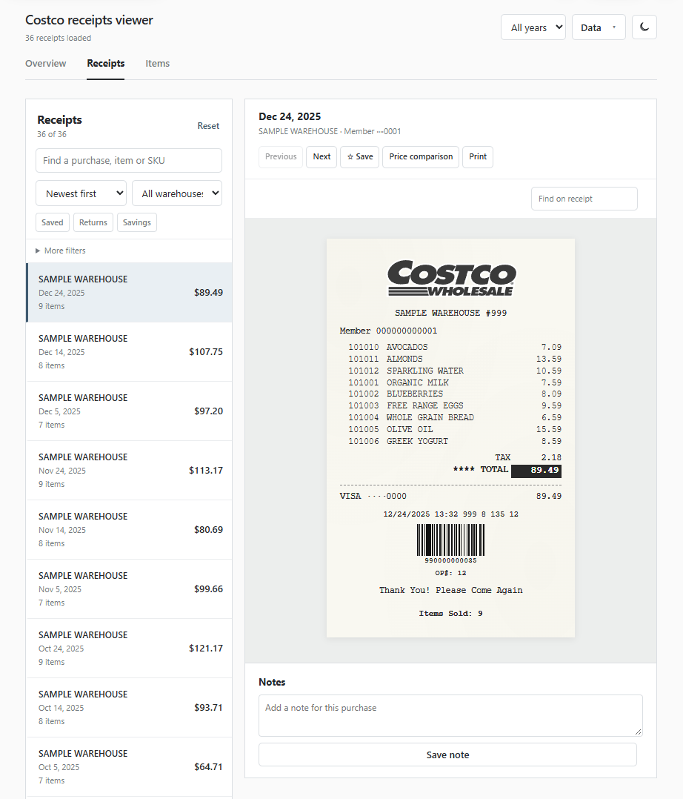

# Kirkland's Costco Receipt Downloader & Dashboard

**Disclaimer:** This is an independent, unofficial project that is not affiliated, endorsed, sponsored by,
or associated with Costco Wholesale Corporation.

**Original creator: [TechStud](https://github.com/TechStud)**

This is a fork of
[TechStud's Costco Receipt Downloader & Dashboard](https://github.com/TechStud/TCRDD).
Full credit for the original project and receipt downloader
goes to TechStud. This fork redesigns the dashboard (example below).

---

## 🎯 Key Features

This project is divided into two interdependent components:

* **[Receipt Downloader](Downloader/)**
    A client-side JavaScript utility designed to _extract and archive_ your Costco in-warehouse receipts, saving the raw data in a standardized JSON format file.

* **[Receipt Dashboard](Dashboard/)**
    A client-side web application built for _visualizing, searching, and conducting detailed analysis_ on the receipt data generated by the **Receipt Downloader**.

---

## 🚀 Getting Started

The project is designed to run entirely on the client-side, making deployment and use straightforward.

1.  **Clone the Repository:** Download or clone the entire project structure from the main repository.
2.  **Access the Downloader:** Once you've logged in to Costco and accessed the _Orders & Returns_ page, open the `Downloader/costco_receipt_downloader.js` file and execute its logic within your browser's developer console.
    - For detailed, step-by-step instructions please refer to the **[Receipt Downloader README](Downloader/README.md)**.
3.  **Use the Dashboard:** Once you have saved your Costco receipt data, simply open the **`Dashboard/Dashboard.html`** file in your browser, load your receipt data file, then visualize and analyze your data.
    - For detailed instructions please refer to the **[Receipt Dashboard README](Dashboard/README.md)**.

---

## 🛠️ Technology Stack

Both components are built on simple, widely-supported web technologies, requiring **no server-side environment** or external dependencies for the core functionality.

* **Front-end & Logic:** **Vanilla JavaScript**
* **Structure:** **HTML5**
* **Styling:** **CSS3**
* **Data Format:** **JSON** (JavaScript Object Notation)

This project leverages the browser's built-in capabilities, ensuring portability and minimal setup. This means you can load it on a portable Drive and/or a mobile device!

---
